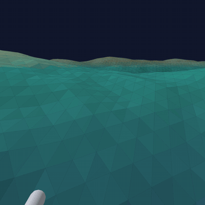
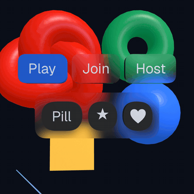
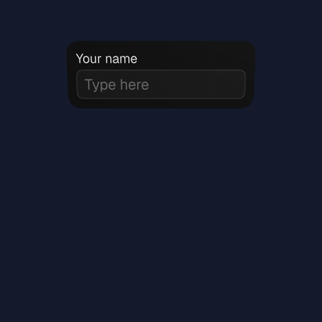
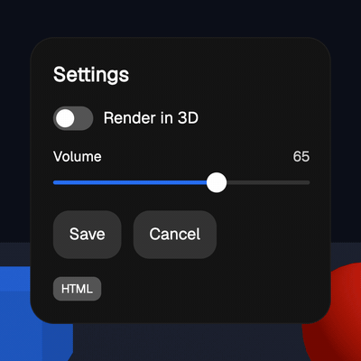

<h1 align="center">xr-kit</h1>

<p align="center">
  <a href="https://www.npmjs.com/package/@xr-kit/ui"></a>
</p>

<p align="center"><strong>An all-in-one kit for building websites that progressively enhance with WebXR.</strong></p>

<p align="center">For use on mobile, desktop, and headset.
Built on Svelte 5, A-Frame 1.8, and Three.js.</p>

<p align="center">
  <a href="https://gad.sh/xr/">Docs</a> · <a href="https://gad.sh/xr/gallery/">Component Gallery</a> · <a href="https://gad.sh/xr/llms.txt">llms.txt</a>
</p>

<p align="center">
  
  
  
  
</p>

| Package | What it is |
| --- | --- |
| [`packages/ui`](packages/ui) (`@xr-kit/ui`) | The design system: Svelte components that render as HTML on a screen, or as A-Frame entities in 3D and VR |
| [`packages/aframe-blink-controls`](packages/aframe-blink-controls) (`@xr-kit/aframe-blink-controls`) | Teleport (`blink-controls`), our fork of `jure/aframe-blink-controls` |
| [`packages/aframe-bvh`](packages/aframe-bvh) (`@xr-kit/aframe-bvh`) | Fast raycasts against big static meshes with three-mesh-bvh (`bvh`) |
| [`packages/aframe-tap-to-move`](packages/aframe-tap-to-move) (`@xr-kit/aframe-tap-to-move`) | Tap or click the floor to move there (`tap-to-move`): on a phone, a desktop, or with a laser in VR |
| [`templates/starter`](templates/starter) | The app to copy (`npx degit gad-sh/xr-kit/templates/starter my-app`): each way to use the library, on a screen and in a headset |
| [`templates/spa`](templates/spa) | A mostly-2D single page app to copy (`npx degit gad-sh/xr-kit/templates/spa my-app`): SvelteKit, HTML pages, and a VR section that loads A-Frame only when it's opened |
| [`apps/gallery`](apps/gallery) | Every component in 2D and 3D, [live](https://gad.sh/xr/gallery/) |
| [`apps/docs`](apps/docs) | The [docs site](https://gad.sh/xr/): guides, every component with live 2D/3D demos and props, and the same pages as Markdown for agents (`llms.txt`) |

## Start a new project

Copy a template with [degit](https://github.com/Rich-Harris/degit) (it downloads the folder,
without the kit's git history), then install and run it:

```sh
npx degit gad-sh/xr-kit/templates/starter my-app
cd my-app
pnpm install
pnpm dev
```

Pick the template that fits:

- **`templates/starter`**: one page for a screen and a VR headset, with a scene, laser
  hands, teleport, and every way to place UI. Start here for a VR-first app.
- **`templates/spa`** (`npx degit gad-sh/xr-kit/templates/spa my-app`): a mostly-2D app
  with SvelteKit, HTML pages, and a VR section that loads A-Frame only when it's opened.

A copy installs the xr-kit packages from npm and works with npm too. Each template's README
says what it shows. Change the `name` in the copy's `package.json`, and its LICENSE if your
project uses another license.

## Using it in an existing project

The project needs Vite with `@sveltejs/vite-plugin-svelte`, Svelte 5 and A-Frame 1.8. A
headset only offers Enter VR on https, so serve the dev server over https
(`vite-plugin-mkcert`, as the starter does).

Install the library, and the A-Frame packages you use:

```sh
pnpm add @xr-kit/ui aframe
pnpm add @xr-kit/aframe-blink-controls  # teleport
pnpm add @xr-kit/aframe-bvh             # fast raycasts against big meshes
pnpm add @xr-kit/aframe-tap-to-move     # tap the floor to move
```

Load A-Frame before everything else, because the library and both A-Frame packages use the
`AFRAME` and `THREE` globals it defines:

```ts
// main.ts
import 'aframe';
import '@xr-kit/aframe-blink-controls'; // only if you use teleport
import '@xr-kit/aframe-bvh';            // only if you use bvh
import '@xr-kit/aframe-tap-to-move';    // only if you use tap-to-move
import { mount } from 'svelte';
import App from './App.svelte';

mount(App, { target: document.getElementById('app')! });
```

Then import components from `@xr-kit/ui` and put the 3D ones in a `<Scene3D>`.
`templates/starter/src/App.svelte` shows each way to use them, and `templates/spa` an app
of 2D pages with SvelteKit.

You can keep loading A-Frame with a `<script>` tag instead of importing it (still before the
app). In that case, don't import `aframe` as well. The library only reads the globals, so it
works unchanged. If you use `@xr-kit/aframe-bvh`, also alias `'three'` in `vite.config.ts` to a module
that re-exports the global `THREE`, so three-mesh-bvh doesn't bundle a second copy (see
`packages/aframe-bvh/README.md`).

### Working on the kit and an app together

To change the kit while you use it in an app, link the packages from a clone instead of
installing them from npm. Clone this repo next to your project and install it:

```sh
git clone git@github.com:gad-sh/xr-kit.git xr-kit
cd xr-kit && pnpm install
```

Then point your dependencies at that folder (the paths assume it's named `xr-kit`).
Edits there show up in your project straight away, with no build step:

```json
"@xr-kit/ui": "link:../xr-kit/packages/ui",
"@xr-kit/aframe-blink-controls": "link:../xr-kit/packages/aframe-blink-controls",
"@xr-kit/aframe-bvh": "link:../xr-kit/packages/aframe-bvh"
```

Linked packages use their own dependencies from this repo's `node_modules`. Vite still
gives the page one Svelte, but svelte-check doesn't. Keep your `svelte` version the same as
this repo's: a mismatch shows as a `Snippet` type error in `Modal.svelte`. (Installed from
npm, the library uses your project's Svelte, so this doesn't apply.)

## Developing the kit

To work on the kit itself, in a clone of this repo:

```sh
pnpm install
pnpm dev     # the starter, on https://localhost:5173 (or the next free port)
pnpm spa     # the single page app template
pnpm gallery # the gallery
pnpm serve-docs # the docs site (pages are apps/docs/content/*.md)
pnpm check   # svelte-check for the library, the templates, the gallery and the docs
pnpm test    # the library's tests, and the docs' coverage of its API (Node's test runner)
```
